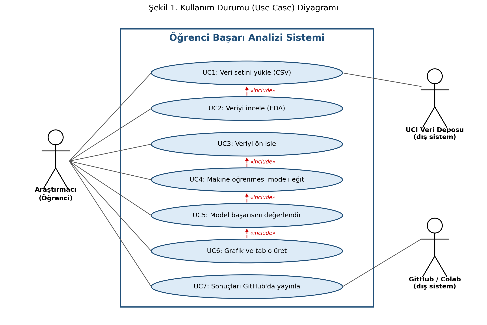
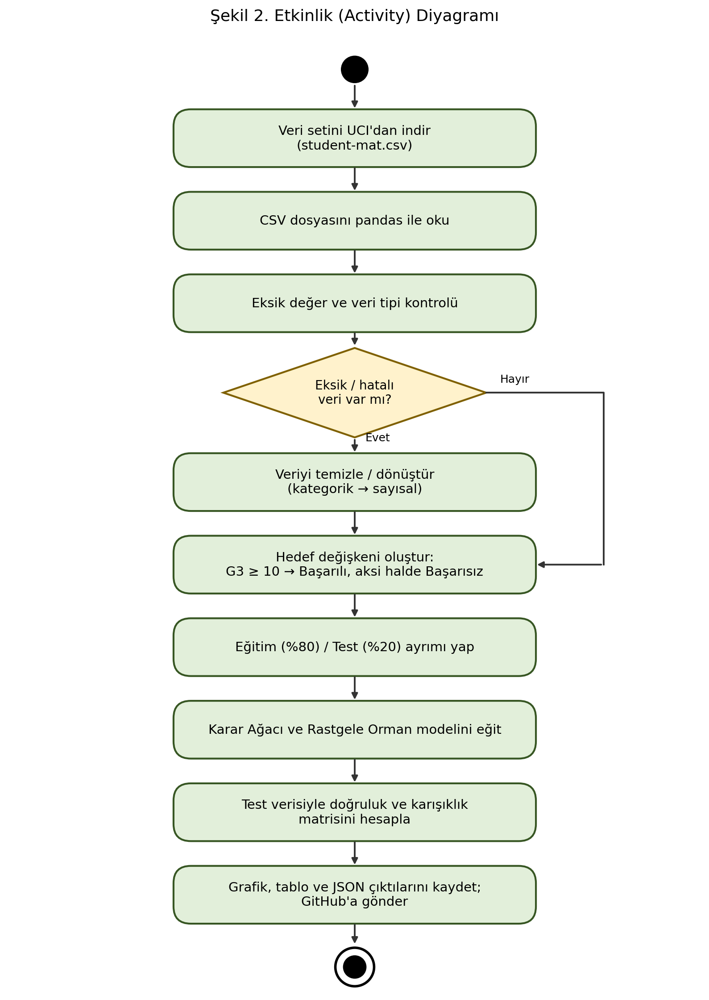
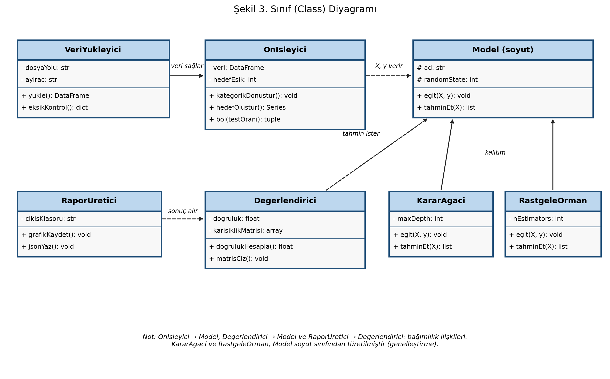

# Öğrenci Akademik Başarısını Etkileyen Faktörlerin Veri Analizi ve Makine Öğrenmesi ile İncelenmesi

**Ders:** Araştırma Yöntem ve Teknikleri (TBY1001) – Marmara Üniversitesi UZEM, Bilgisayar Programcılığı
**Öğrenci:** Kehribal Öztürk • **No:** 361526605 • **Dönem:** 2026 Güz
**Öğretim elemanı:** Dr. Öğr. Üyesi Sezen BAL

> Bu çalışmada **anket veya insan verisi toplanmamıştır.** Yalnızca açık erişimli, lisanslı ve alıntılanabilir bir veri seti kullanılmıştır.

## 1. Problem
Ortaöğretimde öğrencilerin matematik dersindeki final başarısı, yalnızca önceki notlara değil; çalışma süresi, geçmiş başarısızlıklar, devamsızlık, aile ve sosyal koşullar gibi faktörlere de bağlı olabilir. Hangi faktörlerin başarıyla ilişkili olduğunun ve bu faktörlerle başarının ne ölçüde tahmin edilebildiğinin açık veriyle incelenmesi gerekmektedir.

## 2. Araştırma sorusu
Öğrencilerin demografik, sosyal ve akademik özellikleri, matematik dersinde başarılı olup olmadıklarını (G3 ≥ 10) hangi ölçüde tahmin edebilir?

### Alt problemler
1. Öğrencilerin dönem notları (G1, G2, G3) ve devamsızlıkları nasıl dağılmaktadır?
2. Haftalık çalışma süresi gruplarına göre ortalama final notu farklılaşmakta mıdır?
3. Geçmiş başarısızlık sayısı final notuyla nasıl ilişkilidir?
4. Önceki dönem notları (G1, G2) modele dahil edildiğinde ve edilmediğinde sınıflandırma başarısı nasıl değişir?

## 3. Amaç ve önem
**Amaç:** Açık veriyle öğrenci başarısını betimlemek ve karar ağacı/rastgele orman ile sınıflandırmak.
**Önem:** Erken uyarı sistemlerinin hangi değişkenlere ihtiyaç duyduğunu ve yalnızca sosyal/demografik verinin ne kadar yetersiz kalabildiğini göstermesi bakımından eğitim veri madenciliği açısından öğreticidir.

## 4. Değişkenler ve işlemsel tanımlar
| Değişken | Tür | İşlemsel tanım |
|---|---|---|
| `G3` | Bağımlı (sürekli) | Final notu, 0–20 puan |
| `basari` | Bağımlı (ikili) | G3 ≥ 10 ise 1 (başarılı), değilse 0 |
| `studytime` | Bağımsız (ordinal) | Haftalık çalışma süresi: 1 <2 sa, 2 2–5 sa, 3 5–10 sa, 4 >10 sa |
| `failures` | Bağımsız (sayı) | Geçmiş sınıf başarısızlık sayısı (0–3) |
| `absences` | Bağımsız (sayı) | Okul devamsızlık sayısı (0–93 aralığı tanımlı; bu veride 0–75) |
| `G1`, `G2` | Bağımsız (sürekli) | 1. ve 2. dönem notları, 0–20 |
| `higher`, `internet`, `famsup` … | Bağımsız (kategorik) | Yükseköğrenim isteği, internet erişimi, aile desteği vb. (yes/no) |

## 5. Hipotezler
- **H₀₁:** Haftalık çalışma süresi gruplarının ortalama final notları arasında fark yoktur.
- **H₁₁:** Haftalık çalışma süresi gruplarının ortalama final notları arasında fark vardır.
- **H₀₂:** Geçmiş başarısızlık sayısı ile final notu arasında ilişki yoktur.
- **H₁₂:** Geçmiş başarısızlık sayısı arttıkça final notu azalır.

(Bu aşamada betimsel bulgular sunulmuştur; hipotez testleri sonraki aşamada uygulanacaktır.)

## 6. Varsayımlar ve sınırlılıklar
**Varsayımlar:** Veri doğru kaydedilmiştir; gözlemler birbirinden bağımsızdır; G3 ≥ 10 başarı eşiği olarak kabul edilir.
**Sınırlılıklar:**
- Veri iki Portekiz okulundan, 395 öğrenciden oluşur; Türkiye'ye genellenemez.
- Çalışma süresi, alkol tüketimi gibi değişkenler öğrenci beyanına dayanır.
- Küçük örneklem nedeniyle model sonuçları rastgele bölmeye duyarlıdır.
- Çalışma nedensellik iddia etmez, yalnızca ilişkiyi inceler.

## 7. Veri seti
- **Ad:** Student Performance (matematik: `student-mat.csv`, 395 satır; Portekizce: `student-por.csv`, 649 satır)
- **Kaynak:** UCI Machine Learning Repository – https://archive.ics.uci.edu/dataset/320/student+performance
- **DOI:** https://doi.org/10.24432/C5TG7T
- **Lisans:** CC BY 4.0
- **Erişim tarihi:** 15.11.2026
- Veri kişisel kimlik içermez; depoda API anahtarı veya parola bulunmaz.

## 8. Başlangıç yöntemi
1. Veri okuma ve kalite kontrolü (`pandas`)
2. Betimsel istatistik (toplam, ortalama, min, maks) ve grafikler (`matplotlib`)
3. Hedef değişken oluşturma, one-hot kodlama, %80/%20 stratified bölme
4. Karar Ağacı ve Rastgele Orman (`scikit-learn`), çoğunluk sınıfı ile karşılaştırma
5. Doğruluk, F1, karışıklık matrisi, özellik önemi

## 9. Bulgular (özet)
| Deney | Model | Test doğruluğu |
|---|---|---|
| A (G1, G2 dahil) | Çoğunluk (baseline) | 0,671 |
| A | Karar Ağacı | 0,873 |
| A | Rastgele Orman | 0,873 |
| B (G1, G2 hariç) | Çoğunluk (baseline) | 0,671 |
| B | Karar Ağacı | 0,646 |
| B | Rastgele Orman | 0,658 |

- Önceki dönem notları modele girince doğruluk belirgin artar (0,671 → 0,873).
- **Yalnızca sosyal/demografik değişkenlerle** model, çoğunluk sınıfı tahmininin (0,671) altında kalmıştır. Bu veri ve bu basit modellerle bu özellikler tek başına yeterli değildir.
- Betimsel bulgu: ortalama final notu 10,42/20; çalışma süresi arttıkça ortalama not genel olarak artar; geçmiş başarısızlık arttıkça ortalama not düşer (0 başarısızlık: 11,25; 3 başarısızlık: 5,69).

## 10. Literatür (hepsi gerçek, DOI/künye ile)
1. Cortez, P., & Silva, A. M. G. (2008). Using data mining to predict secondary school student performance. *Proceedings of the 5th Future Business Technology Conference (FUBUTEC 2008)*, 5–12. Porto: EUROSIS. (Bu bildirinin ayrı bir DOI'si yoktur.)
2. Cortez, P. (2014). *Student Performance* [Veri seti]. UCI Machine Learning Repository. https://doi.org/10.24432/C5TG7T
3. Romero, C., & Ventura, S. (2010). Educational data mining: A review of the state of the art. *IEEE Transactions on Systems, Man, and Cybernetics, Part C*, 40(6), 601–618. https://doi.org/10.1109/TSMCC.2010.2053532
4. Romero, C., & Ventura, S. (2020). Educational data mining and learning analytics: An updated survey. *WIREs Data Mining and Knowledge Discovery*, 10(3), e1355. https://doi.org/10.1002/widm.1355
5. Shahiri, A. M., Husain, W., & Rashid, N. A. (2015). A review on predicting student's performance using data mining techniques. *Procedia Computer Science*, 72, 414–422. https://doi.org/10.1016/j.procs.2015.12.157
6. Tomasevic, N., Gvozdenovic, N., & Vranes, S. (2020). An overview and comparison of supervised data mining techniques for student exam performance prediction. *Computers & Education*, 143, 103676. https://doi.org/10.1016/j.compedu.2019.103676
7. Yağcı, M. (2022). Educational data mining: prediction of students' academic performance using machine learning algorithms. *Smart Learning Environments*, 9, 11. https://doi.org/10.1186/s40561-022-00192-z
8. Costa-Mendes, R., Oliveira, T., Castelli, M., & Cruz-Jesus, F. (2021). A machine learning approximation of the 2015 Portuguese high school student grades: A hybrid approach. *Education and Information Technologies*. https://doi.org/10.1007/s10639-020-10316-y
9. Ying, D., & Ma, J. (2024). Student performance prediction with regression approach and data generation. *Applied Sciences*, 14(3), 1148. https://doi.org/10.3390/app14031148
10. Angeioplastis, A., Aliprantis, J., Konstantakis, M., & Tsimpiris, A. (2025). Predicting student performance and enhancing learning outcomes: A data-driven approach using educational data mining techniques. *Computers*, 14(3), 83. https://doi.org/10.3390/computers14030083
11. Breiman, L. (2001). Random forests. *Machine Learning*, 45(1), 5–32. https://doi.org/10.1023/A:1010933404324

## 11. Depo yapısı
```
README.md
data/        student-mat.csv, student-por.csv, student.txt (UCI, CC BY 4.0)
notebooks/   Hafta6_Proje_Veri_Analizi.ipynb
             Hafta7_Proje_Makine_Ogrenmesi.ipynb
             Hafta7_Iris_Ogrenci_Colab_ArastirmaYontem.ipynb
outputs/     grafikler (.png), tablolar (.csv), sonuçlar (.json)
uml/         use_case_diagram.png, activity_diagram.png, class_diagram.png
docs/        proje notları
```

## 12. UML diyagramları
| Diyagram | Dosya |
|---|---|
| Kullanım Durumu |  |
| Etkinlik |  |
| Sınıf |  |

- **Kullanım durumu:** Araştırmacı veri yükler, inceler, ön işler, model eğitir, değerlendirir, grafik üretir ve sonuçları GitHub'da yayınlar. UCI ve GitHub/Colab dış sistemlerdir.
- **Etkinlik:** veri indirme → okuma → kalite kontrolü → (gerekirse temizleme) → hedef oluşturma → bölme → eğitim → değerlendirme → çıktıları kaydetme.
- **Sınıf:** `VeriYukleyici`, `OnIsleyici`, `Model` (soyut), `KararAgaci`, `RastgeleOrman`, `Degerlendirici`, `RaporUretici`.

## 13. Çalışma planı (Kanban özeti)
| Aşama | Durum |
|---|---|
| Konu ve veri seçimi | Tamamlandı |
| Literatür taraması | Tamamlandı |
| GitHub deposu | Tamamlandı |
| UML diyagramları | Tamamlandı |
| Hafta 6 veri analizi | Tamamlandı |
| Hafta 7 makine öğrenmesi | Tamamlandı |
| Hipotez testleri | Planlandı |

## 14. Colab bağlantıları
- Hafta 6: `COLAB_HAFTA6_LINKI`
- Hafta 7 (proje): `COLAB_HAFTA7_LINKI`
- Hafta 7 (Iris): `COLAB_IRIS_LINKI`

## 15. Katkı
Bireysel çalışma: Kehribal Öztürk.

## 16. Lisans
Veri: CC BY 4.0 (Cortez, 2014). Kod ve rapor: öğrenci ödevi olarak MIT lisansıyla paylaşılabilir.

